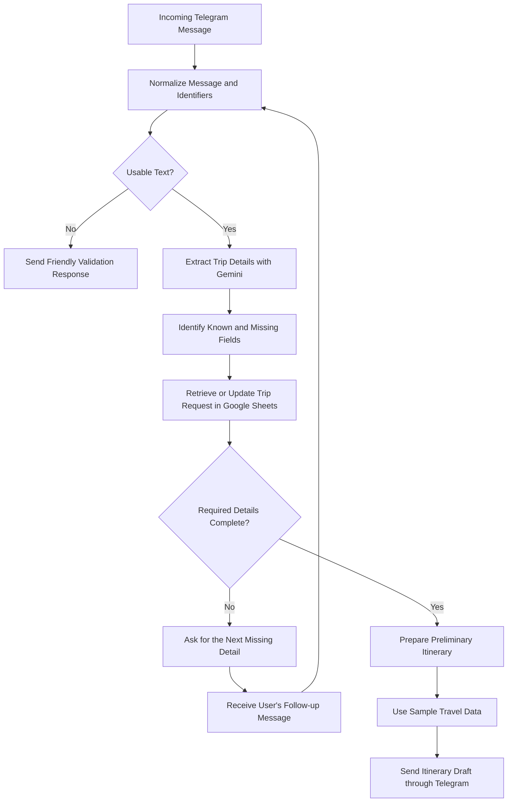

# ATLAS — Travel Planning Workflow Architecture

## Overview

ATLAS is a conversational travel-planning prototype built with n8n, Telegram, Gemini, and Google Sheets.

The workflow collects trip requirements progressively, stores the request's state, and prepares a preliminary itinerary using sample travel data.

This diagram represents the prototype workflow and its current scope. It does not represent a live travel-booking system.

## 1. Travel Request Processing

## 2. Data Collection and Request State

The workflow extracts and tracks available trip information, including:

- Origin and destination
- Trip duration
- Departure date
- Number of travelers
- Budget

Not every field is available in the initial message. ATLAS identifies missing information and continues the conversation to collect the remaining details.

Google Sheets stores the trip record and tracks progress through fields such as the trip identifier, request status, and next required step.

## 3. Technology Responsibilities

| Component | Responsibility |
|---|---|
| Telegram | Receives travel requests and delivers responses |
| n8n | Orchestrates validation, extraction, branching, persistence, and follow-up |
| Gemini | Extracts structured trip details and assists with itinerary drafting |
| Google Sheets | Persists trip details and request progress |
| Sample travel data | Supports preliminary itinerary recommendations without live provider availability |

## 4. Key Engineering Decisions

### Progressive Information Collection

ATLAS does not require every travel detail in the first message. It tracks missing fields and requests additional information in stages.

### Input Validation

Messages are normalized and checked for usable text. Invalid input follows a friendly response path instead of continuing through the ordinary trip-processing path.

### Persistent Request State

Trip details and progress are saved so the workflow can continue collecting information across multiple messages.

### AI-Assisted Extraction

Gemini interprets natural-language travel requests and produces structured trip information for the workflow to use.

### Clear Booking Boundaries

Preparing an itinerary is separate from making a booking. ATLAS does not make travel reservations or claim live availability.

## 5. Current Implementation Status

The prototype has been exercised with Telegram messages, trip-detail extraction, validation responses, progressive collection of missing information, and Google Sheets persistence.

The itinerary workflow uses sample travel data. Live travel-provider integrations, production database-backed memory, and a dedicated web-form interface remain future development work.

## 6. Next Engineering Priorities

1. Test incomplete, ambiguous, and invalid travel requests.
2. Improve handling of repeated messages and interrupted conversations.
3. Test workflow behavior when model or storage requests fail.
4. Explore database-backed request state as the system evolves.
5. Integrate live travel data only with appropriate response validation.
6. Document reproducible test cases and observed results.

## Summary

ATLAS demonstrates how conversational AI and deterministic workflow logic can work together to turn an incomplete travel request into a structured planning process. Its focus is on progressive data collection, persistent state, validation, and a useful preliminary itinerary—not automated booking execution.
