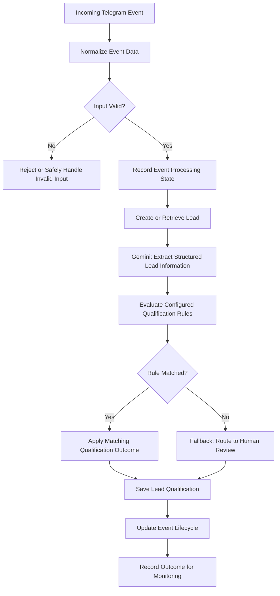
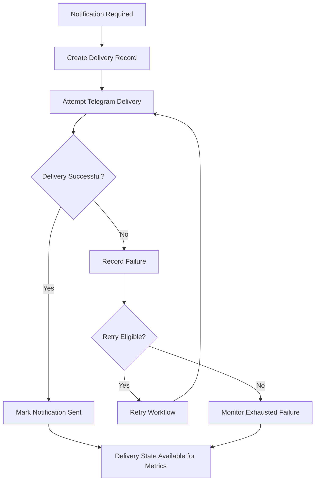

# CENDARA — Workflow Architecture

## Overview

CENDARA combines AI-assisted lead information extraction, deterministic qualification rules, PostgreSQL-backed state, and notification recovery workflows.

The diagram below shows the logical architecture of the system. It is a high-level representation, not an exact node-by-node export of the n8n implementation.

## Lead Processing Flow

## Notification and Recovery Flow

The notification retry workflow is configured with a maximum of three attempts. Exact retry behavior depends on the workflow's eligibility and delivery-state checks.

## Key Design Decisions

### AI and Deterministic Rules

Gemini helps interpret unstructured enquiries and extract relevant information. A separate qualification layer applies configured rules to determine the workflow outcome.

### PostgreSQL as Persistent State

PostgreSQL stores lead records, processed events, notification deliveries, and operational records. This allows workflow behavior to be investigated using persistent data.

### Human Review Fallback

When no configured qualification rule matches, the fallback routes the lead to `needs_review` rather than automatically rejecting it.

### Notification Delivery Tracking

Notification delivery is tracked separately from lead qualification. A lead can have a saved qualification outcome while its notification has a different delivery status.

### Failure Recovery

The notification workflow includes failure tracking, bounded retries, and monitoring for exhausted failures. These controls support recovery but do not guarantee that every possible failure is prevented.

## Current Status

CENDARA is an active portfolio project. Selected processing, qualification, lifecycle-tracking, and notification-recovery paths have been tested. Additional testing is still needed for concurrent event handling, broader failure scenarios, and full operational coverage.

This diagram describes the logical workflow architecture and should not be interpreted as proof that every path has been tested under all conditions.
