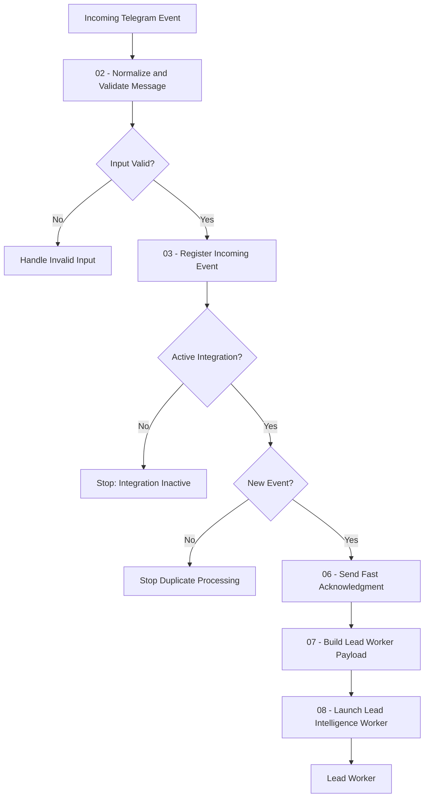
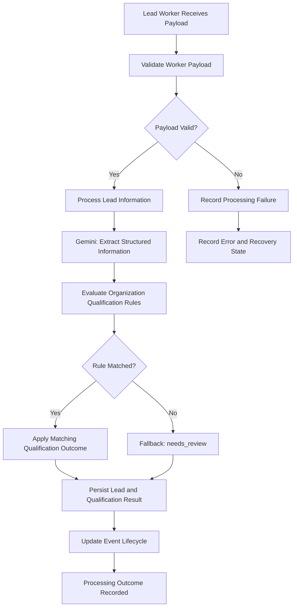
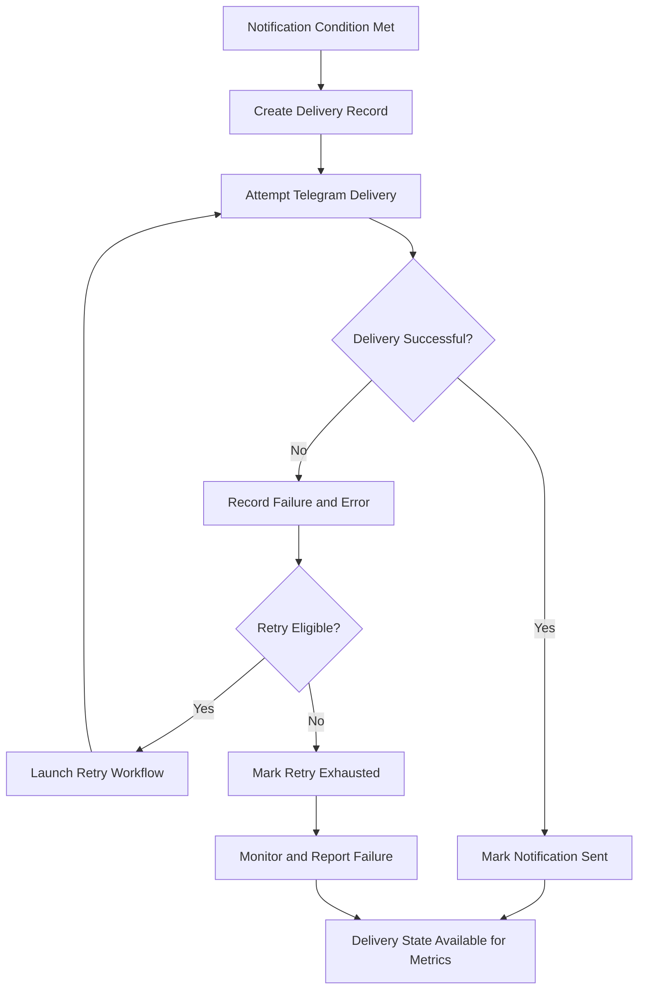

# CENDARA — Workflow Architecture

## Overview

CENDARA combines AI-assisted lead information extraction, deterministic qualification rules, PostgreSQL-backed state management, and notification recovery workflows.

Its architecture separates incoming-message intake and acknowledgement from the more involved lead-intelligence process.

The system uses n8n to orchestrate workflows, PostgreSQL to maintain persistent records, Gemini to interpret natural-language enquiries, and Telegram for message intake and administrative notifications.

The diagrams below represent the logical architecture. They are not exact node-by-node exports of the n8n implementation.

---

## 1. Event Intake and Worker Launch

The intake workflow validates incoming Telegram messages, verifies the relevant channel integration, registers the incoming event, and checks for duplicate events.

New events receive a fast acknowledgement before the lead-intelligence worker is launched.

**Design note:** The fast acknowledgement is separated from downstream AI processing so the initial response does not depend on completion of the lead-intelligence workflow.

---

## 2. Lead Intelligence Processing

The lead worker validates its incoming payload, processes lead information, and uses Gemini to extract structured information from the original enquiry.

The extracted information is evaluated against organization-specific qualification rules before the result is persisted.

Extracted information includes intent, urgency, budget details, requested service, enquiry summary, timeline, and missing information.

AI interpretation is kept separate from deterministic qualification decisions.

---

## 3. Notification Delivery and Recovery

Administrative notifications are tracked independently from lead qualification and event-processing state.

When a configured condition requires an administrative notification, CENDARA creates a delivery record and attempts Telegram delivery.

The notification retry workflow uses a maximum of three delivery attempts.

Eligible failures can be retried within the configured limit. Exhausted failures are identified for operational attention rather than retried indefinitely.

---

## 4. Persistent Data and Operational State

PostgreSQL acts as the persistent source of truth for the system.

The database maintains organization-level records and operational information used by the n8n workflows.

Important data areas include:

| Data area | Responsibility |
|---|---|
| Organizations | Business identity and tenant ownership |
| Channel integrations | Registered communication channels |
| Processed events | Incoming event identity and lifecycle |
| Contacts and conversations | Contact and conversation information |
| Leads | Structured lead information and qualification results |
| AI processing runs | AI-processing records |
| Qualification rules | Organization-specific qualification configuration |
| Routing rules | Lead-routing configuration |
| Follow-up tasks | Follow-up activity |
| Notification deliveries | Notification status, attempts and failure information |

Database constraints and unique indexes provide additional protection against invalid relationships and duplicate lead creation.

The database also supports investigation of processing outcomes and notification failures.

---

## 5. Key Design Decisions

### Separate Intake and Processing

The intake workflow is responsible for validating incoming messages, registering events, detecting duplicates, and sending a fast acknowledgement.

The lead-intelligence worker handles more involved processing, including extraction, qualification and persistence.

This separation prevents the initial acknowledgement from depending on completion of AI processing.

### AI for Interpretation, Rules for Decisions

Gemini interprets natural-language enquiries and extracts structured information.

A separate qualification layer applies configured business rules to determine the resulting lead status and priority.

This makes business decisions more consistent and easier to review.

### PostgreSQL as Persistent State

PostgreSQL stores lead records, processed events, organization configuration and notification-delivery state.

Persistent records allow workflow outcomes to be investigated beyond an individual n8n execution.

### Organization-Level Data Integrity

Organization identifiers scope relevant records and relationships.

Database constraints provide additional protection against invalid cross-organization relationships and duplicate lead records.

### Human Review Fallback

When no configured qualification rule matches, the qualification fallback uses `needs_review` rather than automatically rejecting the enquiry.

### Separate Notification State

Notification delivery is tracked independently from lead qualification and event processing.

A lead can be successfully processed while its administrative notification remains failed or pending recovery.

### Bounded Failure Recovery

The notification workflow includes failure tracking, a maximum of three delivery attempts, and monitoring for exhausted failures.

These controls support controlled recovery but do not guarantee that every possible failure is prevented.

---

## 6. Current Implementation Status

Selected areas of CENDARA have been implemented and tested, including:

- Telegram event normalization and validation.
- Active channel-integration checks.
- PostgreSQL event registration and duplicate detection.
- Fast acknowledgement and lead-worker launch.
- Worker payload construction and validation.
- Lead creation and duplicate-lead safeguards.
- Gemini-assisted information extraction.
- Configured qualification outcomes and unmatched-rule fallback.
- Event lifecycle and timestamp updates.
- Administrative notification delivery tracking.
- Notification success and failure handling.
- Failure logging and exhausted-notification monitoring.

Further validation is required for concurrent event processing, broader failure scenarios, and complete operational coverage.

---

## 7. Current Limitations

CENDARA remains an active portfolio project.

- The diagrams show logical workflow responsibilities rather than every n8n node.
- Testing covers selected execution paths rather than all possible scenarios.
- Concurrent event handling requires further verification.
- External service outages and complex recovery scenarios require additional testing.
- Dashboard metrics need continued validation against source database records.
- Production deployment and measured customer outcomes are not claimed.

---

## Summary

CENDARA uses a hybrid AI automation architecture that combines fast event intake, structured lead processing, deterministic qualification, PostgreSQL-backed state management, and controlled notification recovery.

Its core engineering principle is that reliable automation requires more than connecting services or generating AI responses.

It requires clear workflow boundaries, persistent state, data integrity, traceable decisions, and controlled handling of failures.
