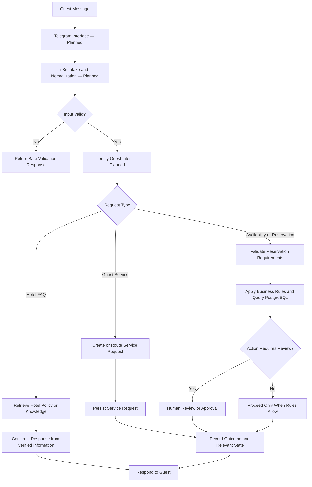
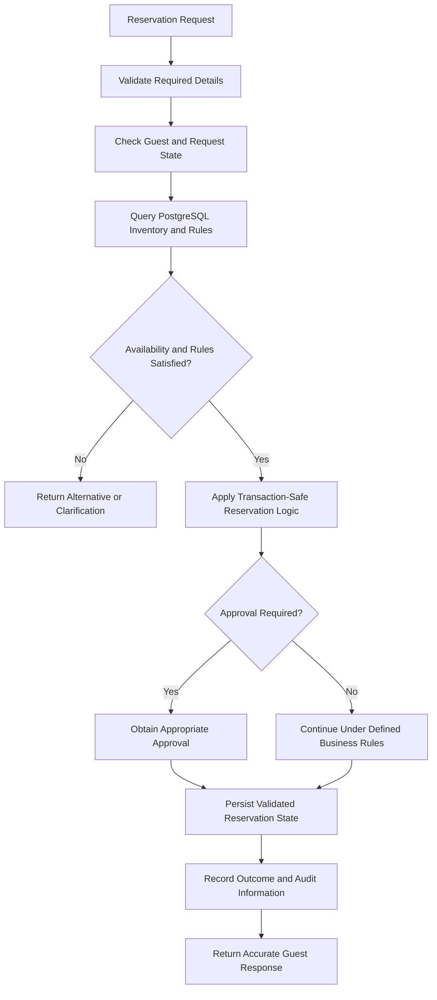

# VELORA — Hotel Operations Architecture

## Overview

VELORA explores how a hotel operations system can combine n8n, PostgreSQL, and AI-assisted communication to support guest enquiries, reservation requests, hotel policies, and service requests.

The project is based on a fictional luxury property, VELORA Grand Dubai.

**Current status:** The PostgreSQL schema foundation has been created and tested in a Neon development database. The diagram below represents the intended system architecture; the complete end-to-end guest workflow remains in development.

## 1. Planned Guest Interaction Flow

This diagram shows the intended guest interaction design, not a claim that each step has already been implemented.

## 2. Database Foundation

PostgreSQL is intended to remain the source of truth for hotel operations. AI can help interpret a guest's message, but availability and reservation decisions should depend on validated database records and explicit business rules.

The database schema foundation developed in Neon includes the following areas:

| Area | Examples |
|---|---|
| Inventory | `room_types`, `rooms`, `rate_rules`, `inventory_blocks` |
| Guest and conversation data | `guests`, `conversations`, `messages` |
| Reservations | `booking_requests`, `reservations`, `reservation_price_items` |
| Service and hotel information | `service_requests`, `hotel_policies`, `knowledge_articles` |
| Reliability and traceability | `processed_events`, `audit_logs`, `operation_records` |

The schema separates room categories from individual physical rooms, supporting a more accurate representation of hotel inventory.

## 3. Intended Reservation Control Flow

This is the planned reservation design. It is not evidence of live inventory checks or successful production booking execution.

## 4. Reliability Principles

### PostgreSQL as the Source of Truth

Operational facts should come from validated database records rather than generated text.

### Duplicate Prevention

Incoming events should be identified with stable identifiers and processed with database-backed idempotency safeguards to reduce duplicate side effects.

### Data Integrity

Constraints and appropriate transaction handling should protect reservation records from conflicting or inconsistent updates.

### Controlled Automation

Actions affecting reservations or guest commitments should follow explicit business rules. Ambiguous or sensitive cases should be routed for review when required.

### Traceability

Event, audit, and operation records are intended to support debugging, monitoring, and evidence-based recovery.

## 5. Current Implementation Status

**Built and tested:** The PostgreSQL schema foundation was created in stages in a Neon development database.

**Still in development:** Telegram intake, complete FAQ and policy retrieval, reservation availability processing, end-to-end guest-service automation, and the integrated reservation experience.

**Not currently claimed:** Live hotel inventory, a real hotel deployment, payment processing, confirmed production reservations, or a fully operating hotel receptionist.

## 6. Next Engineering Priorities

1. Complete database relationships, constraints, and schema validation.
2. Build and test the Telegram intake and input-validation workflow.
3. Implement guest intent routing and policy retrieval.
4. Develop reservation workflows with database-backed safeguards.
5. Add service-request handling, human escalation, and operational logging.
6. Test duplicate events, concurrent requests, failure recovery, and invalid inputs.

## Summary

VELORA is designed to demonstrate how AI-assisted communication can work alongside relational data, explicit business rules, and controlled workflow automation. Its central principle is that AI helps interpret requests, while verified database state and reliable application logic govern operational decisions.
